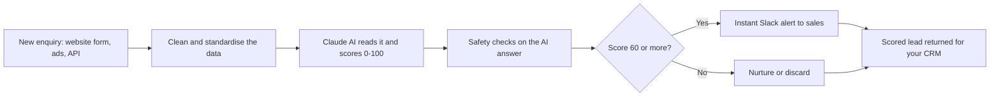

# AI Lead Qualifier

**An AI assistant that reads every new enquiry the moment it arrives, scores how likely it is to become a customer, and tells your sales team who to call first.**

Demo project by **Hamza Tariq**. It runs on sample data and shows how I automate lead handling with n8n and Claude AI.

---

## The problem

Every business that gets enquiries from a website form, ads or email has the same headache:

- **Slow replies.** Someone has to read each message and decide if it matters. A hot lead waits hours, and by then they've called a competitor.
- **Wasted time.** Spam, test submissions and people who are "just looking" take as much effort to read as real buyers.
- **No priority.** Everything lands in one inbox. The team can't tell the urgent, high-budget enquiry from the vague one.
- **No clear picture.** Nobody knows which ads and forms bring in good leads and which bring in junk.

## The solution

This workflow does the reading and sorting automatically. Within seconds of a form being submitted:

1. The lead is captured and its data is cleaned up.
2. An AI reads the full enquiry and scores it from 0 to 100.
3. Good leads trigger an instant alert (for example on Slack) with a one-line reason.
4. Weak leads are marked for nurturing or discarded.
5. Every lead comes back with a score, a status and a recommended next step, ready to go into your CRM.

Your team stops sorting and starts calling the right people.

## How it works



| Step | What happens |
|---|---|
| **1. Capture** | The form sends the enquiry to a webhook. Messy field names (`Email`, `mobile`, `comments`) are standardised. A lead with no email and no phone is rejected. |
| **2. AI scoring** | Claude receives the lead and a scoring guide, and replies with a structured result. |
| **3. Safety checks** | The code checks the AI's answer. It recalculates the status and action from the score, so they always agree. If the AI ever returns something unusable, the lead is flagged for a human instead of being lost. |
| **4. Route** | Leads that score 60 or more can alert the sales team. The rest follow the recommended action. |
| **5. Output** | Score, status, action, reasoning and missing info are returned as JSON for your CRM, sheet or dashboard. |

### How the score is decided

The AI follows a clear 100-point guide, so results are consistent and explainable:

| Factor | Points |
|---|---|
| Contact details provided (email, phone) | 20 |
| How clear and specific the service request is | 25 |
| Urgency (for example "this week", "next month") | 20 |
| Budget mentioned and realistic | 15 |
| Quality and detail of the message | 20 |

Spam, fake emails and test data ("Test User", lottery messages) are scored near zero.

| Score | Status | Recommended action |
|---|---|---|
| 80 to 100 | Qualified, hot lead | Call immediately |
| 60 to 79 | Qualified | Follow up by email |
| 30 to 59 | Needs follow-up | Nurture sequence |
| 0 to 29 | Unqualified | Disqualify |

## Why AI, and not simple rules?

A normal automation can only check fields: "is the budget filled in?", "does the message contain a keyword?". Real enquiries are written in free text, and that is where rules break down.

> *"We need a new site with online booking before our second location opens next month. Budget is flexible."*

A rule-based filter sees no budget number and no keyword, so it may score this lead low. An AI reads it the way a salesperson would. It notices a clear project, a real deadline, a growing business and an open budget, and it marks the lead as a good one.

Where AI helps:
- It **understands intent and urgency** written in natural language.
- It **spots spam and fake submissions** that pass basic field checks.
- It **explains every decision** in plain English, so your team can trust it.
- It **tells you what is missing**, so the first reply can ask the right question.

AI is not left to run unchecked. A fixed scoring guide, structured output and validation in code keep it predictable, and a human review path catches the edge cases.

## Example

**Lead submitted:**
```json
{
  "name": "Sarah Ahmed",
  "company": "Bright Dental",
  "service": "Website redesign with online booking",
  "message": "We need a new site with appointment booking before our second location opens next month. Budget is flexible.",
  "budget": "$5,000-$10,000",
  "urgency": "this month"
}
```

**What comes back** (illustrative format; the score and wording come from the AI on each run):
```json
{
  "qualification": {
    "score": 82,
    "status": "qualified",
    "recommended_action": "immediate_call",
    "reasoning": "Specific project, clear deadline and a realistic budget.",
    "key_signals": ["Specific service", "Urgent timeline", "Budget given"],
    "missing_info": []
  }
}
```

## Who it's for

Businesses that receive enquiries and sell higher-value services: agencies, clinics, real estate, home services, consultants, B2B services and education providers.

## What I can adapt for you

| Your situation | What I'd do |
|---|---|
| You use HubSpot, GoHighLevel, Salesforce or Zoho | Send each scored lead straight into your CRM |
| Leads come from Facebook, Google Ads or WhatsApp | Add those sources to the intake |
| You have your own idea of a good lead | Rewrite the scoring guide to match your business |
| You want faster replies | Add an AI-written first email or message |
| You want reports | Send results to Google Sheets or a dashboard |
| You need a dashboard or web page around it | I can build that too |

## Built with

- **n8n** for the workflow
- **Claude AI (Anthropic)** for reading and scoring leads
- **Slack** for alerts and **Google Sheets** for reports
- **Supabase** (Postgres) for storage and audit logs in the full design

## Run it yourself

The working workflow is in [`quickstart/`](quickstart/). Import [`lead-qualifier-quickstart.json`](quickstart/lead-qualifier-quickstart.json) into n8n, add your Claude API key, and send it [`sample-lead.json`](quickstart/sample-lead.json). Step-by-step setup is in [`quickstart/README.md`](quickstart/README.md).

For the full production design (deduplication, follow-up messages, audit logs, reporting), see [`docs/technical-overview.md`](docs/technical-overview.md).

## See it working

🎥 **Demo video:** _add your Loom link here_

## Work with me

I'm Hamza Tariq, an AI Automation Expert. I build AI automations, chatbots and AI-powered apps that connect to the tools you already use.
Tell me about your lead process on Upwork and I'll suggest how to automate it: _add your Upwork profile link here_
